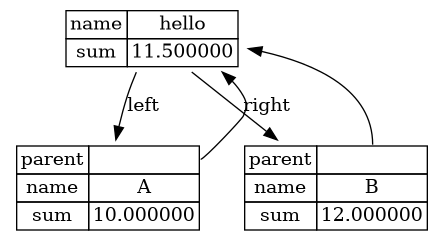

# DSViz

DSViz is a header-only C++11 library for visualization node-based data structure for generating GraphViz dot files. You can copy and put it anywhere you like. 

To visualize your data structure, there are two approaches: invasive or non-invasive

## Basic invasive approach

The invasive approach is very simple, you need to inherit the interface `DSViz::IDataStructure` and implement the dsviz_show method in the data structure that you want to visualize. The bad thing is that you need to modify your data structure. 
 

```c++
struct Node : public DSViz::IDataStructure {
    string name;
    float sum;

    Node* parent;
    Node* left;
    Node* right;

    Node(string name, float sum, Node* left, Node* right) 
        : name(name), sum(sum), parent(nullptr), left(left), right(right) {
        if (left)  left->parent  = this;
        if (right) right->parent = this;
    } 

    virtual void dsviz_show(DSViz::IViz& viz) {
        DSViz::TableNode node(viz, 2);
        viz.setName(this, node.name);
        node.addPointer("parent", parent, "", "", "", "[constraint=false]");
        node.add("name", name);
        node.add("sum", sum);
        node.addEdge(left,  "left");
        node.addEdge(right, "right");
    }
};
```

`TableNode` is the class used for printing table nodes in GraphViz. 
- `addPointer` can set a pointer which is another node
- `add` can add a new field
- `addEdge` links nodes and influence the layout of the graph


## Generate a *.dot file for your data structure

Once you have the data structures, create a `Dot` object and load data structures using the API `load_ds`. You can load any node that can used to access the whole data structure (by keep tracing pointers). Usually, a root node is the one you want to load. We will do a depth-first order traversal to load all nodes in the graph.

Then, `dot.print` will print the GraphViz *.dot format in string. You can output it to a file or print it into stdout.

```c++
    Node A {string("A"), 10.0f, nullptr, nullptr};
    Node B {string("B"), 12.0f, nullptr, nullptr};
    Node hello {string("hello"), 11.5f, &A, &B};

    DSViz::Dot dot;
    dot.load_ds(&hello);
    std::cout << dot.print();
```

You can use `xdot` in Linux to open the graphviz dot file or using `dot` to convert it into a png image:

```
  dot -Tpng filename.dot -o outfile.png
```




## Non-invasive approach

The non-invasive approach is more flexible, you don't need to modify your data structure. You can use a mock class that contains the pointer of nodes and provide a `dsviz_show` function to visualize the data structure. 

Use binary search tree as an example, we may have some code that implements the BST:

```c++
struct bintree_node {
    bintree_node *left;
    bintree_node *right;
    int           data;
};

class bst {
    bintree_node *root;

  public:
    bst() { root = NULL; }
    int  isempty() { return (root == NULL); }
    bintree_node *getRoot() { return root; }
    void insert(int item);
    void displayBinTree();
    void printBinTree(bintree_node *);
};
```

The individual function `dsviz_show` is used to visualize the data structure. It has the following signature:

```c++
void dsviz_show(bintree_node* P, DSViz::IViz &viz);
```
`P` is the pointer of the node, `viz` is the interface for adding nodes and edges.

Then we need to define a mock class which use this function. `DSViz::Mock` is a template that has two parameters: the type of the node and the function for visualization:

```c++
typedef DSViz::Mock<bintree_node, dsviz_show> mock;
```

Finally, we use `mock::get` to map the pointer of the original node to the mock node. It should be used everywhere in the `dsviz_show` function:

```c++
#include "dsv.hpp"
void dsviz_show(bintree_node* P, DSViz::IViz &viz);
typedef DSViz::Mock<bintree_node, dsviz_show> mock;

void dsviz_show(bintree_node* P, DSViz::IViz &viz) {
    DSViz::TableNode node(viz);
    viz.setName(mock::get(P), node.name);
    node.add("data", P->data);
    if (P->left) node.addEdge(mock::get(P->left), "left");
    if (P->right) node.addEdge(mock::get(P->right), "right");
}
```

Then we can print the dot file:
```c++
    DSViz::Dot dot;
    dot.load_ds(mock::get(bst.getRoot()));
    std::cout << dot.print();
```


## API behavior and lifetime

- `load_ds(nullptr)`, `load_ds_c(nullptr)` (with a typed pointer), and
  `Mock::get(nullptr)` are safe: no node is loaded, and the adapter is null.
- Register each node with `viz.setName(pointer, node.name)` **before** following
  its pointers. This is required for cycles and shared children. Traversal is
  recursive; very deep graphs should be bounded by the caller.
- `TableNode` submits its contents on destruction or explicit `Done()`.
  `Done()` is idempotent; finish all edits before calling it. Destroy builders
  before reading the parent graph, or call `Done()` first. A `SubGraph` is
  attached to its parent when it is destroyed; its own `print()` returns a
  complete current subgraph snapshot.
- Node labels, edge labels, and `Node::addAttr` values are literal text and are
  escaped for DOT. Table field names and values are escaped as HTML text.
  Table `attr`/`attr2` arguments are **raw GraphViz HTML attributes**, for example
  `"bgcolor='red'"`. `Config`, raw node/edge declarations, node IDs, and subgraph
  names also accept raw DOT syntax; do not pass untrusted text to these fields.
- Multiple calls to `addEdge` retain multiple edges even with identical endpoints.
  `addPointerC` accepts an optional final raw edge attribute argument, matching
  `addPointer`.
- `getDS(name)` returns `nullptr` for unknown names. `getName(pointer)` throws
  `std::out_of_range` for unknown pointers. Empty node names/endpoints and
  conflicting pointer/name mappings throw `std::invalid_argument`.
  `setName` changes the pointer/name mapping only; it does not rename already
  emitted nodes or edges.
- `Dot::clear()` (also `reset()`) removes the snapshot and resets ID counters,
  preserving configuration. Destroy all builders before resetting. Loading the
  same pointer again is skipped; clear and reload to visualize changed data.
- `dot.write(output_stream)` writes directly to an `std::ostream`;
  `dot.print()` returns the same DOT as a string.
- `Mock` owns its adapters, but does not own the original objects. Original
  objects must remain alive during traversal. The compatibility cache is per
  template specialization and is not thread-safe. `Mock::clearCache()` releases
  adapters; call it only after all graphs and adapter pointers are discarded.
  The cache also releases adapters at process shutdown.

The debugger example uses a dynamically sized, thread-local string plus
`_dotToDebuggerSize()`. The returned pointer remains valid until the next call
on that thread. The Python helper reads exactly that size and reports errors;
its explicit maximum is 64 MiB. HTML is escaped before display.

## Build and test

A C++11 compiler, GNU Make, GraphViz (`dot`), and Python 3 are required:

```sh
make
make -j2 test
make -j2 release
make -j2 sanitize
```

The suite checks API behavior, invalid input, cycles/shared nodes, attributes,
subgraphs, multi-file header linkage, large debugger buffers, and Python bridge
errors. Generated DOT is parsed by GraphViz. Tests remain active in Release
builds, and JUnit/log/DOT/SVG artifacts are saved in `bin/test-results/`.

GitHub Actions covers GCC/Clang, C++11/17/20, Debug/Release, macOS, sanitizers,
and an 85% header line-coverage gate. See [tests/README.md](tests/README.md) for
coverage setup, report locations, CI configuration, and adding tests.
